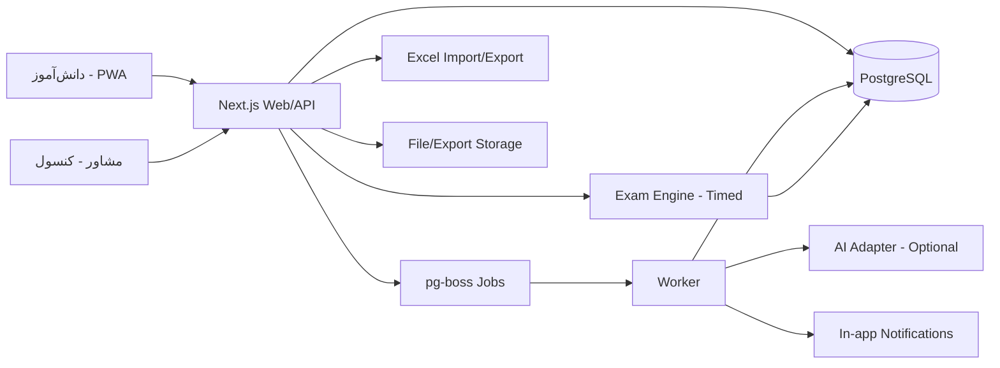

# ADR-0001: دستیار هوشمند مشاور تحصیلی — محصول و معماری MVP

- **وضعیت:** پیشنهادی (Proposed)
- **تاریخ:** ۳ آبان ۱۴۰۵ / 2026-10-25
- **تصمیم‌گیرنده:** تیم محصول و فنی
- **تصمیم‌های تأییدشده:** مشتری = مشاور مستقل (بدون مؤسسه)؛ آزمون زمان‌دار در v1؛ یادآوری فقط درون‌برنامه‌ای.
- **مرتبط:** [بررسی محصولات مشابه](../research/competitor-landscape.md)

---

## خلاصه تصمیم

نسخه اول یک **وب‌اپ موبایل‌محور (PWA)** است برای **مشاور تحصیلی مستقل**، نه یک اپ B2C دیگر برای دانش‌آموز و نه یک سامانه مؤسسه‌ای. مشاور چند دانش‌آموز را مدیریت می‌کند، منابع و زمان‌های آزاد را وارد می‌کند (دستی یا اکسل)، و سیستم یک **پیش‌نویس برنامه هفتگی** با موتور قطعی + کمک AI می‌سازد. مشاور ویرایش و تأیید می‌کند؛ دانش‌آموز فقط «امروز» را می‌بیند، شروع/پایان را ثبت می‌کند و گزارش هفتگی/ماهانه به‌صورت خودکار ساخته می‌شود.

**آزمون زمان‌دار در همین نسخه هست:** مشاور از **بانک سوال اختصاصی خودش** (ایمپورت اکسل) آزمون می‌سازد، سیستم سوالات را بر اساس blueprint انتخاب می‌کند، آزمون سر ساعت باز می‌شود، پاسخ‌ها به‌صورت خودکار ذخیره و در پایان تحویل داده می‌شوند، و نتیجه در تحلیل و برنامه هفته بعد استفاده می‌شود.

هسته فنی:

- **Modular Monolith** با Next.js + TypeScript + PostgreSQL.
- **موتور برنامه‌ریزی قطعی** به‌عنوان مسیر اصلی؛ LLM فقط تخصیص/روایت/انتخاب سوال را بهتر می‌کند و **اختیاری** است.
- **اکسل شهروند درجه‌یک** است: ایمپورت منابع/دانش‌آموزان/زمان‌ها/سوالات و اکسپورت برنامه و گزارش.
- **مشاور در حلقه** است: هیچ برنامه یا آزمونی بدون تأیید او به دانش‌آموز نمی‌رسد.
- تقویم **جلالی**، هفته با شنبه، منطقه زمانی **Asia/Tehran**.
- **یادآوری فقط درون‌برنامه‌ای** است؛ پیامک/تلگرام در v1 نیست.
- بدون بانک سوال ملی، محتوای آموزشی، تست روان‌شناسی، چت آزاد، پرداخت و اپ نیتیو در v1.

هدف: **۸ تا ۱۰ هفته** با یک توسعه‌دهنده تمام‌وقت تا یک نسخه قابل پایلوت با ۲–۳ مشاور و ۳۰–۶۰ دانش‌آموز.

---

## ۱. زمینه

### ۱.۱ مسئله

مشاور تحصیلی در ایران برای هر دانش‌آموز باید:

- برنامه هفتگی بنویسد،
- منابع (کتاب/فصل/تست) و باقی‌مانده آن‌ها را رصد کند،
- زمان‌های آزاد و محدودیت‌های دانش‌آموز را لحاظ کند،
- اجرای روزانه را پیگیری کند،
- و در پایان ماه گزارش بدهد که «چند بار درست شروع کرده» و چقدر از تست‌ها مانده است.

این کار امروز عمدتاً با **اکسل، واتس‌پ/تلگرام و فایل‌های پراکنده** انجام می‌شود. نتیجه:

- زمان زیاد برای کار تکراری،
- خطای انسانی در محاسبه باقی‌مانده منابع،
- عدم شفافیت برای دانش‌آموز،
- گزارش‌های دیرهنگام و غیرقابل اقدام.

### ۱.۲ چشم‌انداز

> هر مشاور بتواند در کمتر از ۱۰ دقیقه برای هر دانش‌آموز یک برنامه هفتگی معتبر بسازد، اجرای آن را روزانه ببیند و در پایان ماه یک گزارش دقیق و قابل اقدام تحویل دهد.

### ۱.۳ چرا الان؟

- بازار ایران پر از اپ‌های B2C «همه‌کاره» شده است (زرنگ، کنکور پلاس، آزنورد، شتاب). رقابت مستقیم با آن‌ها در محتوا و بانک سوال ملی، پرهزینه و دیربازده است.
- هیچ‌کدام «ابزار عملیاتی مشاور» با اکسل، منابع، آزمون زمان‌دار و گزارش ماهانه را به‌عنوان هسته ندارند.
- مدل‌های زبانی فارسی به‌اندازه کافی خوب شده‌اند که بتوان تخصیص و تحلیل را خودکار کرد، اما هنوز برای خروجی کاملاً خودمختار قابل اعتماد نیستند. بنابراین **AI به‌عنوان همکار، نه جایگزین**.
- مشاوران بانک سوال و آزمون اختصاصی خودشان را دارند؛ ارزش ما در **اجرای زمان‌دار و تحلیل آن** است، نه در ساختن بانک ملی سوال.

---

## ۲. اصول محصول

1. **مشاور، مالک تصمیم است.** AI پیشنهاد می‌دهد؛ انسان تأیید می‌کند.
2. **اول اجرا، بعد محتوا.** ارزش اولیه در برنامه‌ریزی، پیگیری، آزمون و گزارش است؛ نه تولید ویدیو یا بانک سوال ملی.
3. **محتوای آزمون را مشاور می‌آورد.** ما بانک سوال نمی‌سازیم؛ ابزار ایمپورت، گزینش و اجرای امن آن را می‌سازیم.
4. **اکسل یک رابط، نه یک دکمه.** اگر مشاور نتواند داده‌اش را سریع وارد و خارج کند، محصول را رها می‌کند.
5. **سادگی برای دانش‌آموز.** دانش‌آموز فقط باید بداند «امروز چه کاری، چه زمانی، چقدر» و سر وقت آزمون را بدهد.
6. **کار در شرایط واقعی ایران.** اینترنت ضعیف، موبایل اندروید، تقویم جلالی، هزینه AI کنترل‌شده.
7. **شفافیت.** هر عدد و پیشنهاد باید قابل ردیابی باشد: از کدام منبع/سوال، به چه دلیل، با چه فرضی.
8. **بدون قفل شدن به یک مدل/سرویس.** آداپتور AI قابل تعویض؛ موتور قطعی همیشه کار می‌کند.

---

## ۳. کاربران و حلقه اصلی

### ۳.۱ نقش‌ها در MVP

| نقش | نیاز اصلی |
|---|---|
| مشاور (Counselor) | صاحب workspace؛ ساخت برنامه و آزمون، رصد چند دانش‌آموز، گزارش ماهانه، کنترل و ویرایش |
| دانش‌آموز (Student) | دیدن کار امروز، ثبت شروع/پایان، دیدن پیشرفت و تست‌های باقی‌مانده، شرکت در آزمون زمان‌دار |

> فرض MVP: هر دانش‌آموز از طریق **دعوت مشاور** وارد می‌شود. ثبت‌نام مستقل دانش‌آموز در فاز بعد. مؤسسه و مدیر مؤسسه در دامنه v1 نیستند.

### ۳.۲ حلقه اصلی (Core Loop)

```text
مشاور دانش‌آموز را می‌سازد/دعوت می‌کند
        ↓
منابع + زمان‌های آزاد + محدودیت‌ها (دستی یا اکسل)
        ↓
موتور برنامه‌ریزی: پیش‌نویس هفته (قطعی + کمک AI)
        ↓
مشاور ویرایش و تأیید می‌کند
        ↓
دانش‌آموز هر روز «امروز» را می‌بیند، شروع/پایان را ثبت می‌کند
        ↓
آزمون زمان‌دار (از بانک سوال خود مشاور) → تصحیح و تحلیل
        ↓
سیستم پیشرفت منابع/تست و «شروع درست» را محاسبه می‌کند
        ↓
گزارش هفتگی/ماهانه + پیشنهاد هفته بعد
        ↓
مشاور تصمیم می‌گیرد؛ چرخه تکرار می‌شود
```

---

## ۴. دامنه MVP

### ۴.۱ در دامنه

| کد | قابلیت | توضیح |
|---|---|---|
| F1 | احراز هویت و نقش‌ها | ورود با شماره موبایل + رمز؛ نقش مشاور/دانش‌آموز/مدیر |
| F2 | مدیریت دانش‌آموزان | ساخت، دعوت با لینک، پایه/رشته/هدف‌های امتحان (نهایی/کنکور/آزمون) |
| F3 | منابع و پیشرفت | کتاب/فصل/تست، تعداد کل، انجام‌شده، اولویت |
| F4 | زمان‌های آزاد | بازه‌های هفتگی، محدودیت روزانه، روز تعطیل، رویدادهای ثابت |
| F5 | برنامه‌ریز هفتگی | تولید پیش‌نویس با موتور قطعی؛ LLM اختیاری |
| F6 | بازبینی مشاور | ویرایش، جابه‌جایی، تأیید، بازتولید |
| F7 | نمای روزانه دانش‌آموز | تسک‌های زمان‌بندی‌شده، دکمه شروع/پایان، ثبت تست، توضیح/لینک کوتاه مشاور |
| F8 | پیشرفت و گزارش | پایبندی، شروع درست، مصرف منابع، گزارش هفتگی/ماهانه |
| F9 | اکسل | قالب ایمپورت + اعتبارسنجی + اکسپورت برنامه و گزارش |
| F10 | اعلان درون‌برنامه‌ای | «پیام شروع» روزانه با اولین تسک، یادآوری و هشدار عقب‌افتادگی؛ فقط درون‌برنامه |
| F11 | تحلیل روایی | متن تحلیلی قالب‌محور؛ بهبود با AI اختیاری |
| F12 | ردپای تغییرات | ثبت تغییرات برنامه/آزمون و اجرای AI برای حسابرسی |
| F13 | بانک سوال اختصاصی | ایمپورت اکسل + افزودن دستی؛ چهارگزینه‌ای تک‌پاسخ و کوتاه‌پاسخ؛ موضوع/سختی/تصویر اختیاری |
| F14 | ساخت و زمان‌بندی آزمون | blueprint (درس/مبحث/تعداد/سختی)، گزینش قطعی + AI اختیاری، پیش‌نمایش، زمان شروع/پایان، تخصیص به یک یا چند دانش‌آموز |
| F15 | اجرای آزمون زمان‌دار | باز شدن سر ساعت، شمارش معکوس، ذخیره خودکار، تحویل خودکار، یک تلاش پیش‌فرض |
| F16 | تصحیح و تحلیل | تصحیح خودکار MCQ، تصحیح دستی کوتاه‌پاسخ، کارنامه، تحلیل مبحث/سوال، ورود نتیجه به برنامه‌ریزی |

### ۴.۲ خارج از دامنه v1

- بانک سوال ملی یا کتابخانه محتوای آماده؛ در MVP فقط بانک سوال اختصاصی مشاور.
- تولید سوال جدید با AI؛ AI فقط از بانک موجود انتخاب می‌کند.
- کتابخانه ویدیو/محتوا و میزبانی فایل آموزشی؛ در MVP فقط یادداشت/لینک متنی روی تسک مجاز است.
- تست روان‌شناسی و تفسیر آن.
- چت آزاد با AI (برای دانش‌آموز یا مشاور).
- پرداخت، اشتراک و صورتحساب.
- اپ نیتیو اندروید/iOS.
- پنل والدین.
- انتخاب رشته و تحلیل کارنامه کنکور.
- همگام‌سازی با گوگل‌کلندر/تقویم‌های خارجی.
- پیامک/تلگرام/واتس‌پ به‌عنوان کانال یادآوری.
- پروکتورینگ، وبکم، تشخیص تقلب و آزمون با نظارت زنده.
- تصحیح خودکار پاسخ تشریحی/دست‌نویس.
- مؤسسه، چند شعبه و مدیر مؤسسه؛ v1 تک‌مشاور است (هر workspace یک مشاور).

> **قاعده:** هر قابلیت جدید فقط بعد از پایلوت و با معیار مشخص وارد نقشه راه می‌شود.

### ۴.۳ تعریف‌های دقیق متریک‌ها

| متریک | تعریف |
|---|---|
| **شروع درست** | اولین تسک برنامه‌ریزی‌شده روز، حداکثر ۳۰ دقیقه بعد از زمان شروع برنامه‌ریزی‌شده، «شروع» شود. اگر تسک بدون زمان باشد، قبل از ساعت ۱۲:۰۰. |
| **روز فعال** | حداقل یک تسک در آن روز «انجام‌شده» شود. |
| **پایبندی روزانه** | مجموع دقایق انجام‌شده تقسیم بر مجموع دقایق برنامه‌ریزی‌شده، سقف هر تسک ۱۰۰٪. |
| **پیشرفت منبع** | واحدهای انجام‌شده تقسیم بر واحدهای کل منبع. |
| **پوشش پیش‌بینی‌شده** | واحدهای باقی‌مانده تقسیم بر ظرفیت هفتگی، مقایسه با هفته‌های باقی‌مانده تا امتحان. |
| **نرخ پذیرش AI** | درصد برنامه‌های AI که مشاور بدون تغییر ساختاری تأیید می‌کند. |
| **نرخ شرکت در آزمون** | تعداد دانش‌آموزانی که آزمون را شروع کرده‌اند تقسیم بر تعداد تخصیص‌یافته. |
| **نرخ تکمیل آزمون** | تعداد تحویل‌های معتبر (شامل تحویل خودکار) تقسیم بر شروع‌شده‌ها. |
| **دقت سوال (p-value)** | درصد پاسخ‌های صحیح به یک سوال بین همه شرکت‌کنندگان. |

---

## ۵. تصمیم‌های معماری

### ۵.۱ پلتفرم: وب‌اپ واکنش‌گرا + PWA

**تصمیم:** یک کدبیس Next.js با دو تجربه:

- **کنسول مشاور:** دسکتاپ‌محور، جدول‌محور، مناسب کار با چند دانش‌آموز.
- **اپ دانش‌آموز:** موبایل‌محور، PWA، قابل نصب روی صفحه اصلی.

**چرا نه اپ نیتیو؟** هزینه دو پلتفرم، زمان انتشار در استور، و نیاز به به‌روزرسانی سریع در پایلوت. PWA برای حلقه MVP کافی است. اپ نیتیو در فاز بعد، اگر نیاز به پوش‌نوتیفیکیشن/آفلاین قوی‌تر بود.

**آفلاین:** کش تسک‌های امروز + صف ثبت رویدادها در IndexedDB. در MVP می‌توان نسخه ساده‌تر (تلاش مجدد + optimistic UI) را کافی دانست، اما مسیر برای صف آفلاین باز است.

### ۵.۲ معماری کلان: Modular Monolith



- **Next.js (App Router)** برای UI و API.
- **PostgreSQL** تنها منبع حقیقت.
- **pg-boss** برای کارهای پس‌زمینه (تولید برنامه، گزارش، اعلان، بستن آزمون‌های منقضی)؛ بدون Redis.
- **Worker** جداگانه با همان کد دامنه.
- **AI Adapter** با پروتکل OpenAI-compatible و مدل/آدرس قابل تنظیم.
- **Exam Engine** داخل مونولیت؛ زمان‌سنجی و اعتبارسنجی سمت سرور.
- **بدون میکروسرویس** در v1. مرزهای ماژولار از روز اول، اما استقرار واحد.

### ۵.۳ موتور برنامه‌ریزی: قطعی + AI اختیاری

**تصمیم:** مسیر اصلی یک الگوریتم قطعی و قابل تست است. LLM فقط سه کار انجام می‌دهد:

1. پیشنهاد تخصیص/اولویت برنامه (خروجی JSON ساختاریافته).
2. نوشتن روایت تحلیلی گزارش.
3. انتخاب/چینش سوال از **بانک سوال موجود** بر اساس blueprint آزمون (اختیاری؛ جایگزین: نمونه‌گیری قطعی).

**چرا؟**

- خروجی LLM به‌تنهایی قابل اعتماد نیست (تجاوز از ظرفیت، نادیده گرفتن محدودیت، توهم منبع/سوال).
- هزینه و دسترسی به API در ایران ناپایدار است.
- موتور قطعی باعث می‌شود محصول حتی بدون AI هم کار کند و قابل تست باشد.
- AI هرگز سوال جدید نمی‌سازد؛ فقط از شناسه‌های موجود در بانک انتخاب می‌کند.

#### ورودی‌ها

- تاریخ شروع هفته (شنبه) و تاریخ امتحان(ها).
- زمان‌های آزاد هر روز و رویدادهای ثابت.
- سقف مطالعه روزانه، روز تعطیل، ساعت ممنوعه.
- دروس و وزن آن‌ها (وزن کنکور/امتحان نهایی × ضعف × فوریت).
- منابع: واحد کل، واحد انجام‌شده، اولویت، نوع واحد (تست/صفحه/فصل).
- لاگ ۱۴ روز گذشته: دقایق، تست، شروع درست، احساس سختی.
- یادداشت مشاور.

#### مراحل الگوریتم

1. **محاسبه ظرفیت:** مجموع بازه‌های آزاد منهای رویدادهای ثابت منهای بافر ۱۵٪.
2. **محاسبه تقاضا:** برای هر درس، `باقی‌مانده ÷ هفته‌های باقی‌مانده`، تعدیل‌شده با اولویت مشاور.
3. **تخصیص هفتگی:** سهم هر درس از ظرفیت، نرمال‌شده؛ سقف/کف برای هر درس.
4. **انتخاب موضوع:** از منبع، به ترتیب فصل/بخش؛ interleaving بین ۲–۳ درس در روز.
5. **تولید مرور:** برای موضوعات تکمیل‌شده ۲ و ۷ روز قبل، بلوک مرور کوتاه.
6. **تخصیص تست:** درصدی از زمان درس (پیش‌فرض ۳۰٪، قابل تنظیم) برای تست.
7. **بسته‌بندی در روز:** بلوک‌های ۲۵–۹۰ دقیقه، استراحت، حداکثر ۲ درس سنگین در روز.
8. **اعتبارسنجی:** محدودیت‌های سخت (ظرفیت، منبع، بازه) و نرم (تعادل، فاصله مرور، تنوع).
9. **ذخیره پیش‌نویس:** همراه با هشدارها و دلیل هر بلوک.

#### نقش LLM

- ورودی: زمینه **بی‌نام‌شده** (بدون نام/تلفن)، شامل شناسه‌ها، منابع، ظرفیت، لاگ‌ها.
- خروجی: تخصیص پیشنهادی + توضیح کوتاه + هشدارها.
- اعتبارسنج با Zod + قواعد سخت. اگر نامعتبر بود: یک بار اصلاح، سپس fallback به قطعی.
- هیچ‌گاه خروجی LLM مستقیم ذخیره/اعمال نمی‌شود.

#### بازبرنامه‌ریزی (Replan)

- تسک‌های انجام‌شده تغییر نمی‌کنند.
- حداکثر ۲۰٪ ظرفیت هفته بعد برای جبران عقب‌افتادگی.
- مابقی یا حذف می‌شود یا به مشاور پیشنهاد می‌شود.
- تولید مجدد با `input_hash` تکراری، پیش‌نویس موجود را برمی‌گرداند (idempotent).

### ۵.۴ مدل داده (MVP)

هر مشاور یک **workspace** دارد؛ همه جدول‌ها `workspace_id` دارند. این کار چندمستأجری را ممکن می‌کند بدون آنکه v1 به مؤسسه گره بخورد.

| موجودیت | فیلدهای کلیدی |
|---|---|
| `workspaces` | id, name, owner_id, created_at |
| `users` | id, workspace_id, role (counselor/student), name, phone, password_hash, status |
| `students` | id, workspace_id, counselor_id, user_id, grade, field, track, guardian_phone, status |
| `exam_targets` | id, student_id, title, exam_type (final/konkur/mock), exam_date, weight |
| `subjects` | id, workspace_id (nullable), title, grade, field, weight |
| `resources` | id, workspace_id, student_id, subject_id, title, unit_type, total_units, completed_units, priority |
| `availability` | id, student_id, weekday (0=شنبه), start_min, end_min, effective_from, effective_to |
| `constraints` | id, student_id, max_daily_minutes, rest_weekday, no_study_after, buffer_pct |
| `plans` | id, student_id, week_start, status (draft/approved/active/archived), version, ai_run_id |
| `tasks` | id, plan_id, plan_date, planned_start, planned_end, subject_id, resource_id, topic, type (study/review/test), target_units, est_minutes, status, actual_started_at, actual_ended_at, actual_units |
| `daily_logs` | id, student_id, log_date, mood, energy, note, first_started_at |
| `reports` | id, student_id, period_type, period_start, period_end, metrics_json, narrative, created_at |
| `notifications` | id, user_id, type, payload_json, read_at, created_at |
| `ai_runs` | id, workspace_id, student_id, kind, model, prompt_version, input_hash, output_json, tokens, cost, status, error |
| `audit_logs` | id, workspace_id, actor_id, action, entity, entity_id, diff_json, created_at |
| `question_banks` | id, workspace_id, title, subject_id, created_by, created_at |
| `questions` | id, bank_id, workspace_id, subject_id, topic, type (mcq/short), difficulty (easy/medium/hard), body, options_json, correct_json, score, explanation, media_key, tags, external_key, status |
| `exams` | id, workspace_id, title, created_by, status (draft/scheduled/open/closed/graded), start_at, end_at, duration_minutes, blueprint_json, question_snapshot_json, shuffle_questions, shuffle_options, max_attempts, total_score, published_at |
| `exam_assignments` | id, exam_id, student_id, status (assigned/started/submitted/absent) |
| `exam_attempts` | id, exam_id, student_id, attempt_no, started_at, deadline_at, submitted_at, status, score, max_score, time_spent_sec |
| `exam_answers` | id, attempt_id, question_id, answer_json, is_correct, score, feedback, graded_by, graded_at |
| `content_items` *فاز ۳* | id, workspace_id, title, type, storage_key, duration, tags |
| `psych_tests` *فاز ۳* | id, workspace_id, instrument, consent, score_json |

**نکته‌های مدل:**

- `plans.week_start` همیشه تاریخ **شنبه** است.
- `plan_date` به‌صورت `date` محلی تهران نگه داشته می‌شود؛ `planned_start/end` به‌صورت `timestamptz`.
- `weekday` برای دسترسی: 0=شنبه ... 6=جمعه.
- `resource.completed_units` می‌تواند مشتق از تسک‌ها باشد، اما برای سرعت و اصلاح دستی، هم ذخیره می‌شود.
- `exams.question_snapshot_json` در زمان انتشار، snapshot کامل متن/گزینه/پاسخ/بارم را قفل می‌کند؛ ویرایش بعدی بانک سوال، آزمون زنده را تغییر نمی‌دهد.
- کلید پاسخ در `questions.correct_json` و snapshot آزمون سمت سرور می‌ماند و در پاسخ‌های API آزمون در حال اجرا ارسال نمی‌شود.
- `audit_logs` برای تغییرات برنامه، انتشار آزمون و تغییر تلاش/نمره الزامی است.

### ۵.۵ قرارداد AI

```json
{
  "week_start": "2026-10-24",
  "strategy_summary": "این هفته تمرکز بر زیست و ریاضی، با مرور فیزیک.",
  "days": [
    {
      "date": "2026-10-24",
      "blocks": [
        {
          "subject_id": "sub_bio",
          "resource_id": "res_bio_3",
          "topic": "ژنتیک - فصل ۵",
          "type": "study",
          "target_units": 20,
          "minutes": 75,
          "reason": "باقی‌مانده زیاد و امتحان نزدیک"
        }
      ]
    }
  ],
  "warnings": ["ظرفیت پنجشنبه کمتر از تقاضای زیست است"]
}
```

**اعتبارسنجی:**

- مجموع دقایق هر روز ≤ ظرفیت منهای بافر.
- `target_units` ≤ باقی‌مانده منبع.
- هر بلوک داخل بازه آزاد و خارج از رویداد ثابت.
- حداقل/حداکثر طول بلوک.
- حداقل یک بلوک مرور برای موضوعات واجد شرایط.
- جمع سهم دروس در محدوده ±۲۰٪ هدف.
- عدم تکرار منبع تمام‌شده.

**حریم خصوصی:** نام، تلفن، نام والد و یادداشت‌های حاوی هویت به LLM فرستاده نمی‌شود؛ فقط شناسه و ویژگی‌های تحصیلی. Prompt version و input hash ذخیره می‌شود.

### ۵.۶ آزمون زمان‌دار (در v1)

**اصل:** بانک سوال را مشاور می‌آورد؛ ما ابزار ایمپورت، گزینش، اجرا و تحلیل را می‌سازیم.

**دامنه:**

- بانک سوال در سطح workspace؛ ایمپورت اکسل یا افزودن دستی.
- انواع سوال: **چهارگزینه‌ای تک‌پاسخ** (تصحیح خودکار) و **کوتاه‌پاسخ** (تصحیح دستی). تشریحی/دست‌نویس در v1 نیست.
- آزمون برای یک دانش‌آموز یا چند دانش‌آموز (آزمون گروهی = همان آزمون با چند تخصیص).
- گزینش سوال: فیلتر قطعی بر اساس درس/مبحث/سختی + نمونه‌گیری لایه‌ای؛ LLM اختیاری برای چینش بهتر، فقط از شناسه‌های موجود.
- زمان‌بندی: `start_at`، `end_at` و `duration_minutes` به وقت تهران.
- تحویل: ذخیره خودکار، امکان ادامه بعد از قطعی، تحویل خودکار در پایان.
- تصحیح: MCQ خودکار؛ کوتاه‌پاسخ توسط مشاور.
- تحلیل: نمره، درصد، دقت هر مبحث، دقت هر سوال (p-value)، زمان صرف‌شده.
- ورود نتیجه به برنامه‌ریزی: دقت مبحث به‌عنوان سیگنال ضعف در هفته بعد (با تأیید مشاور).

**جریان:**

```text
ایمپورت بانک سوال (اکسل/دستی)
        ↓
ساخت blueprint آزمون (درس/مبحث/تعداد/سختی/زمان)
        ↓
گزینش قطعی + بازبینی AI اختیاری → پیش‌نمایش
        ↓
زمان‌بندی + تخصیص به دانش‌آموز(ها)
        ↓
شروع سر ساعت → ذخیره خودکار → تحویل خودکار
        ↓
تصحیح MCQ + تصحیح دستی کوتاه‌پاسخ
        ↓
کارنامه و تحلیل → گزارش و برنامه هفته بعد
```

**قواعد سخت:**

- کلید پاسخ هرگز قبل از تحویل به کلاینت فرستاده نمی‌شود.
- زمان‌سنجی و بستن آزمون کاملاً سمت سرور است؛ به ساعت کلاینت اعتماد نمی‌شود.
- مهلت هر دانش‌آموز = `min(زمان شروع شخصی + duration, end_at)`؛ تأخیر در شروع، زمان اضافه نمی‌دهد. در آزمون گروهی، شروع شخصی همان `start_at` است.
- در زمان انتشار آزمون، **snapshot** از شناسه/ترتیب/بارم سوالات گرفته می‌شود تا ویرایش بعدی بانک، آزمون زنده را تغییر ندهد.
- اگر تعداد سوال کافی نباشد، انتشار آزمون بلاک می‌شود.
- در v1 هر دانش‌آموز یک تلاش دارد؛ تلاش مجدد فقط با ساخت آزمون جدید ممکن است (فیلد `max_attempts` برای آینده رزرو می‌شود).
- تصادفی‌سازی ترتیب سوال/گزینه‌ها اختیاری است.
- v1 برای آزمون‌های کم‌نظارت است؛ پروکتورینگ و تشخیص تقلب ندارد و برای آزمون سرنوشت‌ساز بدون نظارت انسانی توصیه نمی‌شود.
- ظرفیت هدف: تا ۱۰۰ دانش‌آموز هم‌زمان در هر آزمون.

**قرارداد گزینش سوال:**

```json
{
  "exam_id": "exam_123",
  "selected": [
    { "question_id": "q_1", "score": 1 },
    { "question_id": "q_2", "score": 1 }
  ],
  "coverage": {
    "sub_bio": { "ژنتیک": 10, "سینتیک": 5 }
  },
  "warnings": ["برای مبحث ژنتیک فقط ۱۰ سوال با سختی سخت موجود است"]
}
```

**اعتبارسنجی گزینش:** وجود شناسه‌ها، عدم تکرار، تطابق تعداد با blueprint، پوشش مبحث/سختی، مجموع بارم، و عدم استفاده مکرر از سوالات اخیر (اختیاری).

### ۵.۷ اکسل

**ایمپورت:**

- قالب `.xlsx` با شیت‌های `Students`, `Resources`, `Availability`, `Constraints`, `Questions`.
- `Questions`: درس، مبحث، نوع (MCQ/کوتاه‌پاسخ)، سختی، متن، گزینه‌ها، پاسخ صحیح، بارم، توضیح، تگ‌ها، تصویر اختیاری.
- پیش‌نمایش dry-run + خطای سطر‌به‌سطر.
- کلید upsert: `student_phone + resource_title` (یا شناسه در صورت وجود)؛ برای سوالات: `bank_id + external_key`.
- هیچ ایمپورتی بدون تأیید نهایی اعمال نمی‌شود.

**اکسپورت:**

- برنامه هفته (تاریخ جلالی، درس، منبع، نوع، دقیقه، وضعیت).
- گزارش ماهانه (پایبندی، شروع درست، مصرف منابع، تست باقی‌مانده).
- کارنامه آزمون (نمره، درصد، دقت مبحث، دقت سوال، زمان).
- خروجی با ExcelJS و استایل خوانا؛ نام شیت‌ها فارسی.

**تصمیم:** ExcelJS به‌جای کتابخانه‌های سبک‌تر، چون استایل، فرمول و جریان حرفه‌ای‌تر لازم است.

### ۵.۸ تقویم و زمان

- تقویم نمایشی: **جلالی**.
- هفته: **شنبه تا جمعه**.
- منطقه زمانی: **Asia/Tehran**.
- ذخیره: `date` محلی + `timestamptz` برای لحظه‌ها.
- کتابخانه: `date-fns-jalali` + `date-fns-tz` (یا معادل تست‌شده).
- تست واحد برای مرزهای سال، اسفند ۲۹/۳۰، و تبدیل‌های هفته.

### ۵.۹ امنیت و حریم خصوصی

- رمز با **argon2id**؛ نشست HttpOnly/Secure/SameSite.
- RBAC workspace‌محور؛ هر کوئری با `workspace_id`.
- حداقل‌سازی داده؛ عدم ذخیره داده روان‌شناختی در v1.
- رضایت والد/سرپرست برای دانش‌آموز زیر ۱۸ سال در فرایند دعوت.
- کلید پاسخ آزمون فقط سمت سرور؛ در حین آزمون هیچ پاسخ صحیحی در payload کلاینت نیست.
- زمان‌سنجی آزمون با ساعت سرور؛ تحویل خودکار حتی اگر کلاینت بسته شود.
- Audit log برای تأیید/تغییر برنامه، انتشار آزمون و تغییر نمره/تلاش.
- بکاپ روزانه PostgreSQL + نگهداری خارج از سرور.
- حذف/خروجی داده به درخواست مشاور/دانش‌آموز.

### ۵.۱۰ استقرار

- **Docker Compose:** `web`, `worker`, `postgres`, `caddy`, `minio` (تصاویر سوال و خروجی‌ها).
- میزبانی: VPS یا ابر ایرانی (به‌دلیل دسترسی، پرداخت و الزامات احتمالی اینماد).
- AI API از سمت سرور؛ کلید هرگز به کلاینت نمی‌رسد.
- محیط staging جدا + داده نمونه.
- CI: lint, typecheck, unit, e2e smoke (شامل شروع/تحویل خودکار آزمون).

---

## ۶. گزینه‌های بررسی‌شده

### ۶.۱ پلتفرم

| گزینه | مزیت | عیب | تصمیم |
|---|---|---|---|
| PWA + وب | یک کدبیس، انتشار سریع، هزینه کم | پوش‌نوتیفیکیشن/آفلاین محدودتر | **انتخاب شد** |
| اپ نیتیو (React Native/Flutter) | تجربه بومی، پوش قوی | دو پلتفرم، زمان و هزینه بیشتر | فاز بعد |
| بات تلگرام/واتس‌پ | اصطکاک ورود کم | وابستگی به پلتفرم فیلترشده، UI محدود | رد شد برای v1 |

### ۶.۲ معماری

| گزینه | مزیت | عیب | تصمیم |
|---|---|---|---|
| Modular Monolith | سرعت، استقرار ساده، دیباگ آسان | مقیاس‌پذیری تیمی محدود | **انتخاب شد** |
| میکروسرویس | مرزهای واضح، مقیاس مستقل | پیچیدگی عملیاتی زودهنگام | رد شد |
| Serverless کامل | هزینه اولیه کم | محدودیت Cron/Job، وابستگی به سرویس خارجی | رد شد |

### ۶.۳ موتور برنامه‌ریزی

| گزینه | مزیت | عیب | تصمیم |
|---|---|---|---|
| LLM خالص | انعطاف بالا | غیرقابل اعتماد، هزینه، توهم | رد شد |
| الگوریتم قطعی | قابل تست، ارزان، همیشه کار می‌کند | کمتر «هوشمند» | **هسته انتخاب شد** |
| ترکیبی قطعی + LLM | تعادل کیفیت/قابلیت اعتماد | کمی پیچیده‌تر | **انتخاب شد** |

### ۶.۴ بانک سوال و آزمون

| گزینه | مزیت | عیب | تصمیم |
|---|---|---|---|
| بانک سوال ملی ساختنی | تجربه کامل B2C | هزینه محتوایی بالا، رقابت مستقیم با بازیگران بزرگ | رد شد |
| اتصال به API بانک سوال موجود | سرعت و تنوع | وابستگی، هزینه، کیفیت نامشخص | فاز بعد |
| بانک سوال اختصاصی مشاور (BYO) | تمایز، مالکیت محتوا، هزینه کم | مشاور باید محتوا داشته باشد | **انتخاب شد برای v1** |

### ۶.۵ مدل کسب‌وکار

| گزینه | مزیت | عیب | تصمیم |
|---|---|---|---|
| B2C مستقیم | بازار بزرگ | CAC بالا، رقابت محتوایی | رد شد برای v1 |
| B2B به مؤسسه | درآمد متمرکز، بازخورد عمیق | فروش کندتر و خارج از تمرکز فعلی | رد شد برای v1 |
| B2B2C به مشاور | حلقه ارزش واضح، وفاداری بالا، بازخورد عمیق | نیاز به آموزش/فروش | **انتخاب شد برای v1** |

---

## ۷. پیامدها

### مثبت

- محصولی متمایز در فضای اشباع‌شده B2C؛ تمرکز بر مشاور.
- امکان پایلوت سریع با ۲–۳ مشاور و بازخورد واقعی.
- موتور قطعی یعنی محصول بدون AI هم کار می‌کند؛ ریسک هزینه/دسترسی کم.
- اکسل، برنامه، آزمون زمان‌دار و گزارش، ارزش فوری و قابل درک برای مشاور ایجاد می‌کند.
- آزمون زمان‌دار با بانک سوال خود مشاور، بدون هزینه تولید محتوا یک قابلیت جدی می‌سازد.
- معماری ساده، قابل نگهداری توسط تیم کوچک.

### منفی

- جذابیت بصری/هیجانی کمتر از اپ‌های B2C رقیب.
- بدون بانک سوال ملی و محتوای آموزشی، ارزش بلندمدت محدودتر است.
- فروش B2B2C نیازمند اعتماد و آموزش مشاور است.
- کیفیت برنامه به کیفیت ورودی منابع/زمان‌ها وابسته است.
- آزمون زمان‌دار v1 نظارت/پروکتورینگ ندارد و برای آزمون‌های حساس باید با نظارت انسانی استفاده شود.
- برخی قابلیت‌های جذاب (محتوا، تست روان‌شناسی، پروکتورینگ) به فاز بعد می‌رود.

### خنثی

- مونولیت ماژولار؛ در صورت رشد می‌توان worker/planner را جدا کرد.
- چند workspace از روز اول، مهاجرت بعدی را ارزان می‌کند.

---

## ۸. معیارهای موفقیت پایلوت

**دوره:** ۴ هفته، ۲–۳ مشاور، ۳۰–۶۰ دانش‌آموز.

| معیار | هدف |
|---|---|
| زمان ساخت برنامه هفتگی هر دانش‌آموز | < ۱۰ دقیقه (در مقابل ۳۰–۴۵ دقیقه دستی) |
| نرخ پذیرش برنامه AI بدون تغییر ساختاری | ≥ ۷۰٪ |
| دانش‌آموزان با ≥ ۴ روز ثبت در هفته | ≥ ۷۰٪ |
| پایبندی هفتگی میانه | ≥ ۶۰٪ |
| استفاده هفتگی از اکسپورت اکسل | ≥ ۸۰٪ مشاوران |
| زمان تولید گزارش ماهانه | < ۱ دقیقه |
| ماندگاری مشاور پس از ۴ هفته | ≥ ۸۰٪ |
| خطای ایمپورت اکسل | < ۵٪ سطرها |
| آزمون‌های برگزارشده در ۴ هفته | ≥ ۸ آزمون |
| نرخ تکمیل آزمون (شامل تحویل خودکار) | ≥ ۹۰٪ |
| خطای زمان‌بندی/تحویل خودکار آزمون | ۰ مورد |
| استفاده از کارنامه آزمون در تحلیل هفته | ≥ ۷۰٪ آزمون‌ها |

**North Star (پایلوت):** تعداد دانش‌آموزانی که در هفته ≥ ۴ روز فعال‌اند، برنامه تأییدشده دارند و در آزمون هفته شرکت کرده‌اند.

---

## ۹. نقشه راه

| فاز | زمان تقریبی | خروجی |
|---|---|---|
| ۰. پایه | ۳–۵ روز | ریپو، CI، اسکیمای اولیه، احراز هویت، RTL/فونت، Docker |
| ۱. هسته | ۲ هفته | دانش‌آموز، منابع، زمان‌ها، ایمپورت اکسل، موتور قطعی، بازبینی مشاور |
| ۲. حلقه روزانه | ۱.۵–۲ هفته | نمای دانش‌آموز، شروع/پایان، لاگ، پیشرفت، گزارش هفتگی، اعلان درون‌برنامه |
| ۳. آزمون زمان‌دار | ۲ هفته | بانک سوال، ایمپورت، ساخت/گزینش، اجرا، تحویل خودکار، تصحیح، کارنامه |
| ۴. هوش و گزارش | ۱.۵ هفته | LLM اختیاری، روایت تحلیلی، گزارش ماهانه، اکسپورت اکسل |
| ۵. پایلوت | ۱ هفته | داده نمونه، استقرار، ابزار ارزیابی AI، رفع اشکال |
| **جمع** | **۸–۱۰ هفته** | نسخه قابل پایلوت |

### ارزیابی AI (در MVP)

- ۱۰ پروفایل نمونه (پایه/رشته/منبع/ظرفیت متفاوت).
- سنجش: نقض محدودیت سخت (باید صفر)، تعادل دروس، پوشش منابع، فاصله مرور.
- آزمون: گزینش باید فقط از شناسه‌های موجود باشد، پوشش blueprint را رعایت کند و هیچ سوال تکراری/ناموجود برنگرداند.
- ثبت `input_hash` و `prompt_version` برای مقایسه نسخه‌ها.
- ذخیره فاصله ویرایش مشاور تا تأیید (سیگنال کیفیت).

---

## ۱۰. ریسک‌ها

| ریسک | اثر | کاهش |
|---|---|---|
| خروجی نامعتبر AI | برنامه غلط/غیرقابل اجرا | اعتبارسنج سخت + fallback قطعی + تأیید مشاور |
| عدم پذیرش مشاور | شکست پایلوت | اکسل-first، آموزش، همراهی در ۲ هفته اول |
| عدم تعهد دانش‌آموز | داده ناقص، گزارش بی‌معنی | ثبت کم‌اصطکاک، یادآوری، شروع درست، نمای ساده |
| گسترش دامنه | تأخیر | دروازه‌های فازبندی‌شده؛ هر قابلیت جدید فقط با معیار |
| نشت داده دانش‌آموزان | ریسک حقوقی/اعتباری | حداقل‌سازی، RBAC، عدم ارسال PII به LLM، بکاپ امن |
| هزینه/دسترسی AI | توقف قابلیت | آداپتور قابل تعویض، حالت off، caching، سهمیه |
| باگ تقویم جلالی | برنامه/آزمون در روز یا ساعت اشتباه | تست مرزی، ذخیره date محلی، کتابخانه بالغ |
| اختلاف ساعت یا قطعی در آزمون | از دست رفتن پاسخ‌ها/نمره | زمان سرور، ذخیره خودکار، ادامه بعد از اتصال، تحویل خودکار |
| تقلب در آزمون | اعتبار نتیجه | تصادفی‌سازی، یک تلاش، هشدار عدم نظارت؛ پروکتورینگ فاز بعد |
| کیفیت بانک سوال مشاور | آزمون نامعتبر | پیش‌نمایش، اعتبارسنجی ایمپورت، بلاک انتشار در کمبود سوال |
| وابستگی به یک نفر | ریسک نگهداری | تست، مستندسازی، مرزهای ماژولار |
| رقابت با بانک سوال ملی | از دست دادن بازار | تمرکز بر BYO و اتصال/شراکت در فاز بعد، نه ساخت از صفر |

---

## ۱۱. سوالات باز (نیازمند تصمیم قبل از پیاده‌سازی)

1. **مدل درآمد:** اشتراک ماهانه به‌ازای هر دانش‌آموز یا هر مشاور؟
2. **ثبت‌نام مستقل دانش‌آموز:** در v1 فقط دعوت مشاور؟ (فرض: بله)
3. **میزبانی:** الزام میزبانی داخل ایران/اینماد؟ (فرض: VPS/ابر ایرانی برای داده، AI از درگاه قابل دسترس)
4. **بودجه AI:** سقف ماهانه چقدر است؟ (فرض: حالت off پیش‌فرض در پایلوت، LLM فقط برای روایت/گزینش)
5. **مالکیت داده:** داده دانش‌آموز متعلق به مشاور است یا دانش‌آموز؟
6. **انواع سوال v1:** چهارگزینه‌ای + کوتاه‌پاسخ تایپی کافی است؟ (فرض: بله؛ تشریحی دست‌نویس فاز بعد)
7. **آزمون گروهی:** حداکثر چند دانش‌آموز و آیا رتبه‌بندی لازم است؟ (فرض: تا ۱۰۰ نفر، رتبه‌بندی اختیاری)
8. **اثر نتیجه آزمون:** خودکار برنامه را تغییر دهد یا فقط پیشنهاد بدهد؟ (فرض: فقط پیشنهاد؛ تأیید مشاور)
9. **تصویر سوال:** آپلود در MinIO یا فقط لینک خارجی؟ (فرض: آپلود اختیاری در v1)
10. **محتوای فاز بعد:** ساخت، خرید، یا اتصال به API بانک سوال؟
11. **زبان/پایه:** فقط فارسی و متوسطه دوم، یا پوشش دبستان هم؟ (فرض: متوسطه دوم، امتحان نهایی + کنکور)

---

## ۱۲. جمع‌بندی

نسخه اول باید **کوچک، قابل اعتماد و قابل فروش** باشد. کوچک‌ترین حلقه ارزش این است:

> منابع و زمان‌ها → برنامه هفتگی → تأیید مشاور → اجرای روزانه → آزمون زمان‌دار → گزارش و اکسل.

هر چیزی که این حلقه را تقویت نکند (بانک سوال ملی، ویدیو، تست روان‌شناسی، چت، پروکتورینگ) در v1 کنار می‌رود. AI باید در خدمت این حلقه باشد، نه محور آن. با این تصمیم، محصول هم بدون AI کار می‌کند، هم با AI بهتر می‌شود، و هم در برابر رقبای B2C یک جایگاه متمایز دارد: **دستیار مشاور، نه جایگزین او.**
